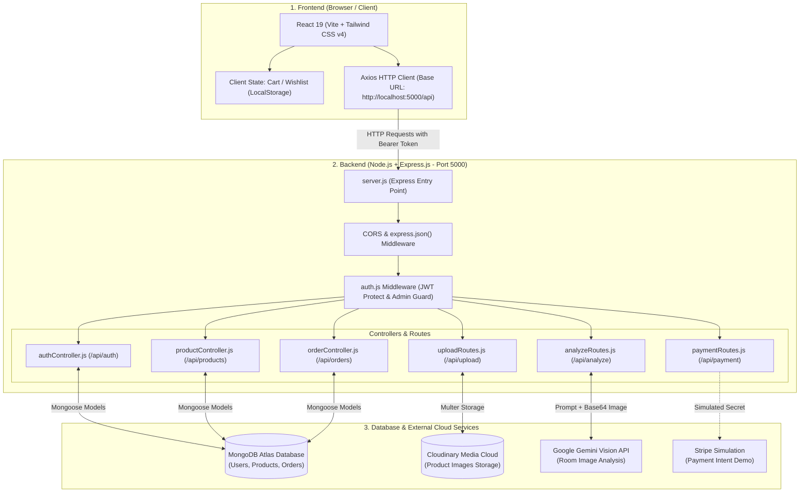
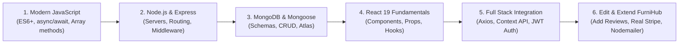

# FurniHub — Complete MERN Stack Beginner Guide & Master Tutorial
### ගෘහ භාණ්ඩ අලෙවිසැල් වෙබ් අඩවිය (FurniHub) මුල සිට සරලව ඉගෙන ගනිමු
*(A Comprehensive Step-by-Step Bilingual Learning Guide: Sinhala & Simple English)*

---

## ආයුබෝවන්! Welcome to FurniHub Master Guide! 👋
මෙම ලේඛනය සකසා ඇත්තේ පරිගණක කේතකරණය (Coding) සහ MERN Stack තාක්ෂණය පිළිබඳව කිසිදු පූර්ව දැනුමක් නැති ආධුනිකයෙකුට (Complete Beginner) වුවද, FurniHub ව්‍යාපෘතියේ සෑම කොටසක්ම පහසුවෙන් තේරුම් ගත හැකි පරිද්දෙනි.

This guide is created for absolute beginners to understand the full-stack architecture of **FurniHub**, a modern furniture e-commerce web platform. Every section is explained first in **Sinhala (සිංහල)** and then in **Simple English**.

---

# PART 1 — BIG PICTURE (මූලික දැක්ම)

---

### 1. What is Furnihub? What problem does it solve? Who are the users?
*(Furnihub කියන්නේ මොකක්ද? විසඳන ගැටලුව කුමක්ද? මෙහි පරිශීලකයින් කවුද?)*

#### 🇱🇰 සිංහල පැහැදිලි කිරීම:
- **Furnihub යනු කුමක්ද?**: Furnihub යනු ගෘහ භාණ්ඩ (Furniture) අන්තර්ජාලය හරහා පාරිභෝගිකයන්ට තෝරාගැනීමට, මිලදී ගැනීමට සහ වෙළඳසැල් හිමිකරුට (Admin) තම භාණ්ඩ කළමනාකරණය කිරීමට සාදන ලද නවීන E-commerce (ඉලෙක්ට්‍රොනික වෙළඳ) වෙබ් අඩවියකි.
- **විසඳන ගැටලුව (Problem Solved)**: සාමාන්‍යයෙන් කඩයකට ගොස් ගෘහ භාණ්ඩ මිලදී ගැනීමේදී තමන්ගේ කාමරයට ගැළපෙන්නේ මොනවාදැයි සිතා ගැනීමට අපහසුය. Furnihub තුළ **AI Room Analyzer (කෘතිම බුද්ධිය)** අඩංගු කර ඇත. පාරිභෝගිකයාට තම කාමරයේ ඡායාරූපයක් (Photo) අප්ලෝඩ් කළ විට, Google Gemini AI මඟින් කාමරයේ ස්වභාවය පරීක්ෂා කර, ගැළපෙන ගෘහ භාණ්ඩ නිර්දේශ (Suggest) කරයි.
- **පරිශීලකයින් (Users)**:
  1. **Customer (සාමාන්‍ය පාරිභෝගිකයා)**: භාණ්ඩ සෙවීම, විස්තර බැලීම, කරත්තයට (Cart) එකතු කිරීම, Wishlist එකට දැමීම, ඇනවුම් කිරීම (Checkout) සහ තම ඇනවුම් තත්ත්වය (Order Status) බැලීම.
  2. **Admin (පරිපාලක / හිමිකරු)**: නව භාණ්ඩ ඇතුළත් කිරීම (Add Product), මිල/තොරතුරු වෙනස් කිරීම (Edit), භාණ්ඩ ඉවත් කිරීම (Delete), ලැබුණු ඇනවුම් පරීක්ෂා කිරීම සහ ඒවායේ තත්ත්වය (Pending -> Processing -> Shipped -> Delivered) යාවත්කාලීන කිරීම.

#### 🇬🇧 Simple English Explanation:
- **What is Furnihub?**: Furnihub is a modern furniture e-commerce website. People can browse and buy furniture online. Store owners can manage products and orders.
- **Problem it solves**: Customers often do not know which furniture fits their room style. Furnihub solves this using an **AI Room Analyzer**. You upload a room photo, and Google Gemini AI suggests suitable furniture items.
- **Types of Users**:
  1. **Customer**: Searches for products, adds items to cart or wishlist, checks out, and tracks previous orders.
  2. **Admin**: Adds new furniture with photos, updates prices, deletes products, and manages customer order statuses.

#### 🌟 Main Features Found in the Code (කේතය තුළ ඇති ප්‍රධාන අංග):
1. **Product Catalog & Filtering**: Search products by text and filter by 8 categories (`living-room`, `bedroom`, `dining`, `office`, `outdoor`, `storage`, `lighting`, `decor`).
2. **AI Room Analyzer**: Upload room image to Google Gemini Vision API to receive color palettes, room style, and matching product suggestions (`/room-analyzer`).
3. **Cart Management**: Add to cart, adjust quantities, slide-out cart drawer, and local storage persistence.
4. **Wishlist**: Save favorite items with instant heart toggle.
5. **Secure Authentication**: User registration and login using JWT (JSON Web Tokens) and Bcrypt password hashing.
6. **Multi-step Checkout**: 3-step checkout workflow (Shipping Address -> Payment selection [Card / Cash on Delivery] -> Order Review).
7. **Order Tracking (My Orders)**: Customers can view all past orders, line items, and fulfillment statuses.
8. **Admin Panel (`/admin/*`)**:
   - Role-based route protection (`AdminGuard`).
   - Dashboard with 4 live statistic counters (Total Products, Total Orders, Total Users, Total Revenue).
   - Full Product CRUD with image uploads to Cloudinary.
   - Live Order status updates (`pending`, `processing`, `shipped`, `delivered`, `cancelled`).

---

### 2. What is the MERN Stack?
*(MERN Stack කියන්නේ මොකක්ද? Furnihub තුළ එය භාවිත වන්නේ කෙසේද?)*

#### 🇱🇰 සිංහල පැහැදිලි කිරීම:
MERN යනු වෙබ් යෙදුමක් (Web App) මුල සිට අගට සෑදීමට භාවිත කරන තාක්ෂණ 4ක එකතුවකි:
1. **M - MongoDB (දත්ත ගබඩාව / Database)**:
   - *සරල උපමාව*: අපේ සියලුම ලේඛන සහ පොත්පත් සුරක්ෂිතව තැන්පත් කර ඇති කබඩ් එකක් වැනිය.
   - *Furnihub තුළ කාර්යය*: පරිශීලකයින්ගේ තොරතුරු (Users), ගෘහ භාණ්ඩ විස්තර (Products) සහ ඇනවුම් තොරතුරු (Orders) ස්ථිරව තැන්පත් කර තබා ගනී.
2. **E - Express.js (පසුතල රාමුව / Backend Framework)**:
   - *සරල උපමාව*: හෝටලයක වේටර්වරයා (Waiter) වැනිය. පාරිභෝගිකයා ඉල්ලන කෑම ලැයිස්තුව මුළුතැන්ගෙට ගෙන ගොස්, කෑම පිළියෙල වූ පසු නැවත පාරිභෝගිකයාට ගෙනැවිත් දෙයි.
   - *Furnihub තුළ කාර්යය*: Frontend එකෙන් එන ඉල්ලීම් (Requests) ලබාගෙන, නිවැරදිදැයි පරීක්ෂා කර, MongoDB එකෙන් දත්ත අරන් නැවත ලබාදෙයි.
3. **R - React (පෙරමුණ / Frontend UI Library)**:
   - *සරල උපමාව*: හෝටලයේ අලංකාර කෑම කාමරය සහ මෙනු පත (Menu card) වැනිය. පාරිභෝගිකයාට පෙනෙන, අතපත ගෑමට හැකි සියලු දේ මෙහි ඇත.
   - *Furnihub තුළ කාර්යය*: වෙබ් අඩවියේ බොත්තම් (Buttons), පින්තූර (Images), Slider, ෆෝරම් (Forms) වැනි පාරිභෝගිකයා දකින අතුරුමුහුණත (User Interface) පාලනය කරයි. මෙහි React 19 සහ Vite භාවිත වේ.
4. **N - Node.js (ධාවන පරිසරය / Runtime Environment)**:
   - *සරල උපමාව*: සාමාන්‍යයෙන් JavaScript දුවන්නේ වෙබ් බ්‍රව්සරය (Chrome) ඇතුළේ පමණි. Node.js යනු JavaScript භාෂාව පරිගණකයේ Server එක තුළ කෙළින්ම ධාවනය කිරීමට දෙන එන්ජිමයි.
   - *Furnihub තුළ කාර්යය*: අපේ Express Backend එක පරිගණකයේ හෝ සේවාදායකයේ (Server) පණගන්වා තබන්නේ Node.js මගිනි.

#### 🇬🇧 Simple English Explanation:
MERN is an acronym for four technologies working together:
1. **M — MongoDB**: The Database. It stores data like users, products, and orders in flexible JSON-like documents.
2. **E — Express.js**: The Backend Web Framework. It listens to incoming requests from the browser, runs security checks, and sends back responses.
3. **R — React**: The Frontend User Interface. It creates the screens, buttons, cards, and pages you see in the browser.
4. **N — Node.js**: The Engine. It runs JavaScript code on the computer server outside of the web browser.

---

### 3. Architecture Diagram
*(පද්ධතියේ ගෘහ නිර්මාණ සටහන)*



---

# PART 2 — PROJECT STRUCTURE (ප්‍රොජෙක්ට් එකේ ගොනු සැකැස්ම)

---

### 4. Full Directory Tree & Folder Explanation
*(සම්පූර්ණ ෆෝල්ඩර් ව්‍යුහය සහ එක් එක් ෆෝල්ඩරයේ කාර්යය)*

```text
f:\MERN_FurnitureShop
├── backend/                       <-- Backend Server Source Code (Node.js + Express)
│   ├── config/                    <-- Configuration files (Database & Cloudinary)
│   │   ├── cloudinary.js          <-- Cloudinary image upload storage config
│   │   └── db.js                  <-- Mongoose MongoDB connection function
│   ├── controllers/               <-- Business logic handlers for API endpoints
│   │   ├── authController.js      <-- Signup, login, and get current user logic
│   │   ├── orderController.js     <-- Order creation, order tracking, and admin stats
│   │   └── productController.js   <-- Product fetching, adding, updating, deleting
│   ├── middleware/                <-- Request filters & security guards
│   │   └── auth.js                <-- protect (JWT verify) & adminOnly (role check)
│   ├── models/                    <-- Database structure definitions (Mongoose Schemas)
│   │   ├── Order.js               <-- Order schema (items, shipping, status, total)
│   │   ├── Product.js             <-- Product schema (name, price, category, image)
│   │   └── User.js                <-- User schema (name, email, password, role)
│   ├── routes/                    <-- URL Route endpoints definition
│   │   ├── analyzeRoutes.js       <-- POST /api/analyze (AI room analyzer)
│   │   ├── authRoutes.js          <-- /api/auth routes (signup, login, me)
│   │   ├── orderRoutes.js         <-- /api/orders routes (my, stats, status)
│   │   ├── paymentRoutes.js       <-- /api/payment/create-intent route
│   │   ├── productRoutes.js       <-- /api/products CRUD routes
│   │   └── uploadRoutes.js        <-- /api/upload image upload routes
│   ├── .env                       <-- Private secret keys (DB URI, JWT secret, Cloudinary)
│   ├── package.json               <-- Backend dependencies & run scripts
│   ├── seed.js                    <-- Script to populate sample furniture into MongoDB
│   └── server.js                  <-- Main backend entry file (Express app startup)
│
├── frontend/                      <-- Frontend Client Source Code (React 19 + Vite)
│   ├── public/                    <-- Static public files (favicon, logos)
│   ├── src/                       <-- React application source code
│   │   ├── api/                   <-- HTTP Network Layer
│   │   │   └── axios.js           <-- Central Axios instance with JWT interceptors
│   │   ├── components/            <-- Reusable UI visual components
│   │   │   ├── admin/             <-- Admin dashboard UI components
│   │   │   │   ├── AdminGuard.jsx <-- Route guard: blocks non-admins
│   │   │   │   └── AdminLayout.jsx<-- Sidebar & navbar layout for admin pages
│   │   │   ├── cart/              <-- Cart screen components
│   │   │   │   └── CartContents.jsx<- Item table, quantity buttons & order summary
│   │   │   ├── common/            <-- Shared global components
│   │   │   │   └── Header.jsx     <-- Main navbar with search, cart badge, menu
│   │   │   ├── home/              <-- Modular Home page sections
│   │   │   │   ├── BestSellingProducts.jsx
│   │   │   │   ├── CTABanner.jsx
│   │   │   │   ├── CategorySection.jsx
│   │   │   │   ├── CustomerReviews.jsx
│   │   │   │   ├── FeaturesBar.jsx
│   │   │   │   ├── HeroSection.jsx
│   │   │   │   ├── NewArrivals.jsx
│   │   │   │   ├── RoomInspirationGallery.jsx
│   │   │   │   ├── SpecialOfferBanner.jsx
│   │   │   │   ├── WhyChooseUs.jsx
│   │   │   │   └── constants.jsx  <-- Static mockup data for home page sections
│   │   │   └── layout/            <-- Page structure wrappers
│   │   │       ├── CartDrawer.jsx <-- Slide-over drawer when cart icon is clicked
│   │   │       ├── Footer.jsx     <-- Comprehensive footer with links & newsletter
│   │   │       ├── Topbar.jsx     <-- Top notification bar (e.g., Free delivery)
│   │   │       └── UserLayout.jsx <-- Customer wrapper containing Outlet and Footer
│   │   ├── context/               <-- Global state managers (React Context API)
│   │   │   ├── AuthContext.jsx    <-- Login state, user profile, token persistence
│   │   │   ├── CartContext.jsx    <-- Cart item list, add/remove, localStorage sync
│   │   │   └── WishlistContext.jsx<-- Liked products list, localStorage sync
│   │   ├── data/                  <-- Static data files
│   │   │   └── products.js        <-- Fallback products list used by Sale page
│   │   ├── pages/                 <-- Route destination page components
│   │   │   ├── admin/             <-- Admin management pages
│   │   │   │   ├── AdminDashboard.jsx <- Live revenue, order & user statistics
│   │   │   │   ├── AdminOrders.jsx    <- List orders & change fulfillment status
│   │   │   │   └── AdminProducts.jsx  <- Add/Edit/Delete products & upload photos
│   │   │   ├── About.jsx          <-- Company background and mission
│   │   │   ├── Account.jsx        <-- Customer profile and link to admin dashboard
│   │   │   ├── Cart.jsx           <-- Full cart page
│   │   │   ├── Checkout.jsx       <-- 3-step shipping & payment checkout
│   │   │   ├── Contact.jsx        <-- Contact details & inquiry message form
│   │   │   ├── FAQ.jsx            <-- Frequently Asked Questions
│   │   │   ├── Home.jsx           <-- Landing page assembling home components
│   │   │   ├── Login.jsx          <-- User login form
│   │   │   ├── MyOrders.jsx       <-- User's personal order history list
│   │   │   ├── NotFound.jsx       <-- 404 page for invalid URLs
│   │   │   ├── PrivacyPolicy.jsx  <-- Privacy notice
│   │   │   ├── ProductDetails.jsx <-- Single item details, gallery & related items
│   │   │   ├── Products.jsx       <-- Catalog with category tabs, search & sorting
│   │   │   ├── Returns.jsx        <-- Return policy information
│   │   │   ├── RoomAnalyzer.jsx   <-- AI room image scanner & furniture suggestions
│   │   │   ├── Sale.jsx           <-- Discounted products view
│   │   │   ├── ShippingPolicy.jsx <-- Shipping terms
│   │   │   ├── Signup.jsx         <-- New user registration form
│   │   │   ├── Terms.jsx          <-- Terms and conditions
│   │   │   └── Wishlist.jsx       <-- Saved favorite products list
│   │   ├── App.css                <-- Base styles
│   │   ├── App.jsx                <-- Master router configuration & context wrapping
│   │   ├── index.css              <-- Global Tailwind CSS stylesheet
│   │   └── main.jsx               <-- React root entry point (mounts to index.html)
│   ├── index.html                 <-- Single Page Application HTML document
│   ├── package.json               <-- Frontend dependencies & scripts
│   └── vite.config.js             <-- Vite bundler configuration
└── README.md                      <-- Original project overview
```

---

### 5. Detailed Breakdown of Key Files & How They Connect
*(ප්‍රධාන ගොනු සහ ඒවා එකිනෙක සම්බන්ධ වන ආකාරය)*

#### 1. `backend/server.js`
- **සිංහල**: පසුතලයේ (Backend) ප්‍රධාන දොරටුවයි. සේවාදායකය (Server) ආරම්භ කරන්නේ මෙතැනිනි. MongoDB එකට සම්බන්ධ වීමට `connectDB()` කැඳවයි. CORS (බ්‍රවුසරයට ඉඩදීම) සහ `express.json()` (JSON දත්ත කියවීම) සක්‍රීය කරයි. සියලුම API ලිපින (Routes) මෙහි ලියාපදිංචි කරයි. කිසිදු Route එකකට අයිති නැති ඉල්ලීමක් ආවොත් 404 පණිවිඩයක්ද, දෝෂයක් ආවොත් 500 Global Error පණිවිඩයක්ද යවයි.
- **English**: The main entry point of the backend Express server. It loads `.env`, connects to MongoDB, sets up CORS and JSON parsers, registers all API routes, and listens on port 5000.

#### 2. `backend/config/db.js`
- **සිංහල**: Mongoose මගින් MongoDB Atlas වෙත සම්බන්ධ වීමේ කේතය අඩංගු ගොනුවයි. සම්බන්ධය සාර්ථක නම් host නම Console එකේ පෙන්වයි. දෝෂයක් ආවොත් සේවාදායකය නවත්වයි (`process.exit(1)`).
- **English**: Connects the Node application to the MongoDB Atlas database using Mongoose. If connection fails, it logs an error and exits the process.

#### 3. `backend/models/User.js`, `Product.js`, `Order.js`
- **සිංහල**: දත්ත ගබඩාවේ (Database) දත්ත තැන්පත් විය යුතු නීති සහ හැඩතල (Schemas) තීරණය කරන ගොනු 3කි. උදාහරණයක් ලෙස User ගොනුවේ Password එක save වීමට පෙර encrypt (රහස්‍ය කේතයක් බවට පත් කිරීම) කිරීමේ කාර්යයද මෙහි ඇත.
- **English**: These files define how documents look inside MongoDB. `User.js` also contains logic to automatically hash passwords using Bcrypt before saving.

#### 4. `backend/middleware/auth.js`
- **සිංහල**: මුරකරුවෙකු (Security Guard) වැනි ගොනුවකි. ආරක්ෂිත API වලට කෙනෙකු එන විට, ඔහු එවූ Token එක නිවැරදිදැයි පරීක්ෂා කරයි (`protect`). Admin පමණක් යා යුතු තැන්වලදී ඔහු Admin කෙනෙක්දැයි පරීක්ෂා කරයි (`adminOnly`).
- **English**: Acts as a security checkpoint. `protect` verifies the JWT token and attaches the user to `req.user`. `adminOnly` ensures the user's role is `admin`.

#### 5. `frontend/src/api/axios.js`
- **සිංහල**: Frontend එක Backend එක සමඟ දුරකථන ඇමතුමක් මෙන් කතාබස් කරන සන්නිවේදන මාධ්‍යයයි. `localStorage` එකේ Token එකක් තිබේ නම්, එය ඉබේම සෑම Request එකකටම `Authorization: Bearer <token>` ලෙස එකතු කරයි (Interceptor). Token එක කල් ඉකුත් වී 401 දෝෂයක් ආවොත් ඉබේම Logout කර දමයි.
- **English**: Creates a configured Axios client pointing to `http://localhost:5000/api`. An interceptor automatically attaches the JWT token from `localStorage` to outgoing requests, and clears the session if a 401 error occurs.

#### 6. `frontend/src/context/AuthContext.jsx`, `CartContext.jsx`, `WishlistContext.jsx`
- **සිංහල**: මුළු වෙබ් අඩවියටම පොදු දත්ත (Global State) රඳවා ගන්නා තැන්ය. ඔබ Login වූවාද, Cart එකේ බඩු කීයක් තිබේද, Wishlist එකේ මොනවාද යන්න ඕනෑම පිටුවකට ලබාදෙන්නේ මෙම Context හරහාය. පිටුව Refresh කළද දත්ත මැකී නොයන ලෙස `localStorage` තුළ තබා ගනී.
- **English**: State management stores using React Context API. They manage user login sessions, shopping cart contents, and wishlist items across the entire app and keep them synced with `localStorage`.

#### 7. `frontend/src/App.jsx`
- **සිංහල**: Frontend එකේ මහා මාර්ග සැලැස්ම (Router) යි. බ්‍රවුසරයේ ලියන URL එක අනුව පෙන්විය යුතු පිටුව (Page Component) තීරණය කරන්නේ මෙතැනිනි. උදා: `/products` ගිය විට `Products.jsx` පෙන්වයි. `/admin/*` ගිය විට `AdminGuard` මගින් ආරක්ෂා කර `AdminLayout` පෙන්වයි.
- **English**: The master route controller using React Router DOM. It wraps the entire application with Context Providers and maps URLs to page components.

---

# PART 3 — BACKEND DEEP DIVE (Node + Express + MongoDB)

---

### 6. MongoDB Models / Schemas Explained
*(දත්ත ගබඩා ආකෘති සහ සම්බන්ධතා)*

> **තාක්ෂණික පදය: Schema & Model**
> - *සරල උපමාව*: රජයේ හැඳුනුම්පතක් සෑදීමට පුරවන අයදුම්පතක් (Application Form) සිතන්න. එහි නම, උපන් දිනය, ජාතික හැඳුනුම්පත් අංකය ලියන කොටු ඇත. එම හිස් ආකෘතිය **Schema** එකකි. එම ආකෘතියට අනුව දත්ත පුරවා හැඳුනුම්පත් මුද්‍රණය කරන යන්ත්‍රය **Model** එකකි.
> - *Simple Explanation*: A Schema is the blueprint defining what fields a document must have. A Model is the programming tool used to find, create, update, and delete documents following that schema.

#### A. `User` Model (`backend/models/User.js`)
| Field (ක්ෂේත්‍රය) | Type (වර්ගය) | Required (අනිවාර්යද?) | Default / Rules | කාර්යය (Purpose) |
|---|---|---|---|---|
| `name` | String | ඔව් (True) | Trimmed | පරිශීලකයාගේ නම |
| `email` | String | ඔව් (True) | Unique, Lowercase | ඊමේල් ලිපිනය (එකම ඊමේල් දෙකක් තිබිය නොහැක) |
| `password` | String | ඔව් (True) | Minlength: 6 | මුරපදය (Bcrypt මගින් Hash කර ගබඩා වේ) |
| `role` | String | නැත | Enum: `['user', 'admin']`, Default: `'user'` | පරිශීලක තනතුර (සාමාන්‍ය පාරිභෝගික හෝ ඇඩ්මින්) |
| `createdAt` / `updatedAt` | Date | ස්වයංක්‍රීය | `{ timestamps: true }` | සෑදූ සහ යාවත්කාලීන කළ වේලාව |

#### B. `Product` Model (`backend/models/Product.js`)
| Field | Type | Required | Default / Rules | Purpose |
|---|---|---|---|---|
| `name` | String | True | Trimmed | භාණ්ඩයේ නම |
| `category` | String | True | Enum: `['living-room', 'bedroom', 'dining', 'office', 'outdoor', 'storage', 'lighting', 'decor']` | භාණ්ඩ වර්ගය |
| `price` | Number | True | Min: 0 | විකුණුම් මිල ($) |
| `oldPrice` | Number | False | `null` | වට්ටමට පෙර මුල් මිල ($) |
| `rating` | Number | False | `0`, Min: 0, Max: 5 | තරු ලකුණු අගය (1 සිට 5 දක්වා) |
| `reviews` | Number | False | `0` | අදහස් දැක්වූ ගණන |
| `badge` | String | False | Enum: `['', 'New', 'Sale', 'Bestseller', 'Best Seller', 'Top Rated', 'Trending']` | භාණ්ඩයේ අලවා ඇති ලේබලය |
| `emoji` | String | False | `'🪑'` | හුරුබුහුටි අයිකනය |
| `description` | String | False | `''` | භාණ්ඩයේ විස්තරය |
| `colors` | Array of String | False | `[]` (උදා: `['#8B5E2E', '#3D3A36']`) | ලබාගත හැකි වර්ණ කේත |
| `inStock` | Boolean | False | `true` | තොග තිබේද නැද්ද යන්න |
| `sku` | String | False | `unique: true, sparse: true` | භාණ්ඩ කේතය (Stock Keeping Unit) |
| `imageUrl` | String | False | `''` | Cloudinary හෝ Unsplash පින්තූර URL එක |

#### C. `Order` Model (`backend/models/Order.js`)
- **සම්බන්ධතා (Relationships)**:
  - `user`: `mongoose.Schema.Types.ObjectId` හරහා `User` collection එකට සම්බන්ධ වේ (`ref: 'User'`).
  - `items[].product`: `mongoose.Schema.Types.ObjectId` හරහා `Product` collection එකට සම්බන්ධ වේ (`ref: 'Product'`).
- **Fields List**:
  - `user`: ඇනවුම කළ පරිශීලකයාගේ ID එක.
  - `items`: ඇනවුම් කළ භාණ්ඩ ලැයිස්තුව (එක් එක් භාණ්ඩයේ `product` ID, `name`, `price`, `qty`, `emoji`).
  - `shippingAddress`: භාණ්ඩ එවිය යුතු ලිපිනය (`fullName`, `email`, `phone`, `address`, `city`, `postalCode`, `country`).
  - `paymentMethod`: ගෙවීම් ක්‍රමය (Enum: `['card', 'cod']`).
  - `subtotal`: භාණ්ඩවල එකතුව.
  - `shippingCost`: ප්‍රවාහන ගාස්තුව.
  - `total`: සම්පූර්ණ එකතුව (`subtotal + shippingCost`).
  - `status`: ඇනවුමේ වත්මන් තත්ත්වය (Enum: `['pending', 'processing', 'shipped', 'delivered', 'cancelled']`, Default: `'pending'`).

---

### 7. Complete API Endpoints Table
*(සියලුම Backend API ලිපින ලැයිස්තුව)*

| HTTP Method | API URL Endpoint | Controller Function | Authorization (ප්‍රවේශ අවසරය) | විස්තරය (Description) |
|---|---|---|---|---|
| **GET** | `/` | In-line in `server.js:35` | Public (ඕනෑම අයෙකුට) | API Server සක්‍රීයදැයි පරීක්ෂා කිරීම (Health Check) |
| **POST** | `/api/auth/signup` | `authController.signup` | Public | නව ගිණුමක් ලියාපදිංචි කිරීම (පළමු පරිශීලකයා Admin වේ) |
| **POST** | `/api/auth/login` | `authController.login` | Public | ගිණුමට ඇතුළුවී JWT Token එක ලබාගැනීම |
| **GET** | `/api/auth/me` | `authController.getMe` | Logged-in User (`protect`) | තමන්ගේ පරිශීලක විස්තර බැලීම |
| **GET** | `/api/products` | `productController.getProducts` | Public | සියලු භාණ්ඩ බැලීම (Category සහ Search query සහාය දක්වයි) |
| **GET** | `/api/products/:id` | `productController.getProductById` | Public | එක් භාණ්ඩයක සම්පූර්ණ විස්තර බැලීම |
| **POST** | `/api/products` | `productController.createProduct` | Admin Only (`protect`, `adminOnly`) | නව භාණ්ඩයක් ඇතුළත් කිරීම |
| **PUT** | `/api/products/:id` | `productController.updateProduct` | Admin Only (`protect`, `adminOnly`) | පවතින භාණ්ඩයක තොරතුරු වෙනස් කිරීම |
| **DELETE** | `/api/products/:id` | `productController.deleteProduct` | Admin Only (`protect`, `adminOnly`) | භාණ්ඩයක් ඩේටාබේස් එකෙන් මකා දැමීම |
| **POST** | `/api/orders` | `orderController.createOrder` | Logged-in User (`protect`) | අලුත් ඇනවුමක් (Order) තැබීම |
| **GET** | `/api/orders/my` | `orderController.getMyOrders` | Logged-in User (`protect`) | තමන් තැබූ ඇනවුම් ලැයිස්තුව බැලීම |
| **GET** | `/api/orders` | `orderController.getAllOrders` | Admin Only (`protect`, `adminOnly`) | සියලුම පාරිභෝගිකයින්ගේ ඇනවුම් බැලීම |
| **GET** | `/api/orders/stats` | `orderController.getDashboardStats` | Admin Only (`protect`, `adminOnly`) | ඇඩ්මින් Dashboard එකේ සංඛ්‍යාලේඛන සහ ආදායම් එකතුව බැලීම |
| **PUT** | `/api/orders/:id/status` | `orderController.updateOrderStatus` | Admin Only (`protect`, `adminOnly`) | ඇනවුමක තත්ත්වය වෙනස් කිරීම (`shipped`, `delivered` ආදී) |
| **POST** | `/api/upload` | In-line in `uploadRoutes.js:7` | Admin Only (`protect`, `adminOnly`) | Cloudinary වෙත පින්තූරයක් Upload කිරීම |
| **DELETE** | `/api/upload/:public_id` | In-line in `uploadRoutes.js:18` | Admin Only (`protect`, `adminOnly`) | Cloudinary හි ඇති පින්තූරයක් මකා දැමීම |
| **POST** | `/api/analyze` | In-line in `analyzeRoutes.js:10` | Public | කාමරයේ පින්තූරය Gemini AI වෙත යවා විග්‍රහයක් ලබාගැනීම |
| **POST** | `/api/payment/create-intent` | In-line in `paymentRoutes.js:7` | Logged-in User (`protect`) | අනුකරණය කරන ලද Stripe Payment Secret එකක් සෑදීම |

---

### 8. Authentication & Authorization Step by Step
*(ලියාපදිංචිය, ලොගින් වීම, පාස්වර්ඩ් ආරක්ෂාව සහ ඇඩ්මින් අවසර)*

> **තාක්ෂණික පදය: JWT (JSON Web Token)**
> - *සරල උපමාව*: විනෝද උද්‍යානයකට (Theme Park) ඇතුළු වන විට අතේ බඳින විශේෂිත මුද්‍රාව සහිත පටිය (Wristband) සිතන්න. සෑම ක්‍රීඩාවකටම යන විට මුදල් ගෙවීමට හෝ හැඳුනුම්පත පෙන්වීමට අවශ්‍ය නැත; ආරක්ෂකයා එම අත්පටිය බලා ඔබව ඇතුළට යවයි.
> - *Simple Explanation*: A JWT is a digitally signed encrypted text string. Once you log in, the server gives you this token. You attach it to future requests so the server knows who you are without asking for your password again.

#### පියවරෙන් පියවර ක්‍රියාවලිය (Step-by-Step Flow):
1. **Signup (ලියාපදිංචි වීම)** (`backend/controllers/authController.js:10-39`):
   - පාරිභෝගිකයා නම, ඊමේල් සහ මුරපදය එවයි.
   - ඊමේල් එක දැනටමත් තිබේදැයි බලයි.
   - **විශේෂ ලක්ෂණය**: ඩේටාබේස් එකේ පළමු පරිශීලකයා නම් (`userCount === 0`), ඔහු ඉබේම `admin` බවට පත්වේ! අනෙක් සියලු දෙනා `user` වේ.
2. **Password Hashing (මුරපදය සංකේතනය කිරීම)** (`backend/models/User.js:33-38`):
   - සරල මුරපදය (උදා: `secret123`) කිසිවිටෙකත් ඩේටාබේස් එකේ එලෙසම තැන්පත් නොවේ.
   - `bcrypt.genSalt(10)` මගින් ලුණු (Salt) දමා අනවශ්‍ය අයට කියවිය නොහැකි අකුරු ගොඩක් බවට හෑෂ් කරයි (උදා: `$2a$10$X8m...`).
3. **Login (ඇතුළුවීම)** (`backend/controllers/authController.js:42-65`):
   - පරිශීලකයා ලබාදුන් මුරපදය `user.matchPassword(password)` හරහා Bcrypt මඟින් සසඳයි.
   - නිවැරදි නම්, `jwt.sign({ id: user._id }, process.env.JWT_SECRET, { expiresIn: '30d' })` මගින් දින 30ක් වලංගු Token එකක් සාදා Frontend වෙත යවයි.
4. **Protected Routes (ආරක්ෂිත මාර්ග පරීක්ෂාව)** (`backend/middleware/auth.js:5-28`):
   - Request එකේ Header එකෙහි `Authorization: Bearer <token>` තිබේදැයි බලයි.
   - `jwt.verify()` මගින් Token එක පරීක්ෂා කර, අදාළ පරිශීලකයා සොයාගෙන `req.user` වෙත අමුණයි.
5. **Admin Check (පරිපාලක පරීක්ෂාව)** (`backend/middleware/auth.js:31-36`):
   - `req.user.role === 'admin'` දැයි බලයි. එසේ නොවේ නම් `403 Forbidden - Admin access required` දෝෂය යවයි.

---

### 9. Middleware, Error Handling, File Uploads, AI Analysis & Payment
*(අතරමැදි මෘදුකාංග, දෝෂ කළමනාකරණය, පින්තූර අප්ලෝඩ්, AI සහ ගෙවීම්)*

> **තාක්ෂණික පදය: Middleware**
> - *සරල උපමාව*: ගුවන් තොටුපළක ගුවන් යානයට නැගීමට පෙර ගමන් මලු ස්කෑන් කරන සහ වීසා පරීක්ෂා කරන ආරක්ෂක මුරපොළවල් (Security Checkpoints) වැනිය. ප්‍රධාන කාර්යය වීමට පෙර ඉල්ලීම පිරිසිදු කර පරීක්ෂා කරන්නේ Middleware මගිනි.
> - *Simple Explanation*: A function that runs in the middle, between receiving an HTTP request and sending the final response.

#### 1. Global Error Handling (`backend/server.js:45-48`)
- Backend එකේ කිසියම් නොසිතූ දෝෂයක් (Exception) ආවොත් සේවාදායකය Crash නොවී, `res.status(500).json({ message: 'Something went wrong', error: err.message })` ලෙස පිළිවෙළකට පණිවිඩයක් එවයි.

#### 2. Image Upload via Cloudinary + Multer (`backend/routes/uploadRoutes.js` & `backend/config/cloudinary.js`)
- පින්තූර අපේ පරිගණකයේ තබා ගන්නේ නැත.
- `multer-storage-cloudinary` මඟින් Admin අප්ලෝඩ් කරන පින්තූර කෙළින්ම Cloudinary Server එකට යවා, එහි ප්‍රමාණය 800x600 ට සකසා, ලැබෙන `https://res.cloudinary.com/...` URL එක ලබාදෙයි.

#### 3. AI Room Analysis (`backend/routes/analyzeRoutes.js`)
- Google Gemini AI (`@google/generative-ai` package, model: `gemini-3.6-flash`) භාවිත කරයි.
- කාමරයේ පින්තූරය Base64 string එකක් ලෙස Gemini වෙත යවයි.
- කාමරයේ වර්ගය, මෝස්තරය (Modern/Minimalist), වර්ණ කේත (Color Hex codes) සහ නිර්දේශිත කාණ්ඩ (`suggestedCategories`) JSON ආකෘතියෙන් ආපසු ලබාදෙයි.

#### 4. Payments Integration (`backend/routes/paymentRoutes.js`)
- **කේතය තුළ ඇති දේ (In Code)**: Stripe client secret එකක් අනුකරණය කරන (Simulated) endpoint එකක් ඇත (`POST /api/payment/create-intent`).
- **සැබෑ තත්ත්වය**: සැබෑ මුදල් අයවීමක් මේ මොහොතේ සිදු නොවේ. Checkout එකේදී ක්‍රෙඩිට් කාඩ් හෝ Cash on Delivery තෝරා ඇනවුම තැබිය හැක.

#### 5. Email Integration:
- ⚠️ **NOT FOUND IN PROJECT**: කේතය තුළ Nodemailer හෝ SendGrid වැනි සැබෑ ඊමේල් යවන Service එකක් අඩංගු කර නැත. ඇනවුම සම්පූර්ණ වූ පසු තිරයේ පමණක් *"A confirmation email has been sent"* යන පණිවිඩය පෙන්වයි.

---

### 10. Environment Variables (.env) Explained
*(පරිසර විචල්‍යයන් පිළිබඳ විස්තරය)*

> **තාක්ෂණික පදය: Environment Variables (.env)**
> - *සරල උපමාව*: ඔබගේ නිවසේ ආරක්ෂිත සේප්පුව (Safe box) වැනිය. කිසිවෙකුට නොපෙන්විය යුතු රහස් යතුරු සහ මුරපද ප්‍රසිද්ධ කේතය (Code) ඇතුළේ ලියන්නේ නැතිව, වෙනම `.env` නම් රහස් ලිපිගොනුවක තබා ගනී.

| Environment Variable | කාර්යය (Sinhala Purpose) | English Purpose |
|---|---|---|
| `MONGODB_URI` | MongoDB Atlas දත්ත ගබඩාවට සම්බන්ධ වීමට අවශ්‍ය URL එක. | Connection connection string for the remote MongoDB Atlas cluster. |
| `JWT_SECRET` | පරිශීලකයාගේ Token එක අත්සන් කිරීමට ගන්නා රහස් යතුර. | Secret key used by JSON Web Token to sign and verify session tokens. |
| `PORT` | Backend සේවාදායකය ක්‍රියාත්මක වන තොටුපළ අංකය (Default: 5000). | The network port on which the Express server listens (defaults to 5000). |
| `CLIENT_URL` | Backend එකට සම්බන්ධ වීමට අවසර ලත් Frontend ලිපිනය (`http://localhost:5173`). | Allowed origin URL for CORS requests coming from the React client. |
| `CLOUDINARY_CLOUD_NAME` | Cloudinary ගිණුමේ නම. | Name of your registered Cloudinary cloud account. |
| `CLOUDINARY_API_KEY` | Cloudinary API එකට ඇතුළු වීමට දෙන Public Key එක. | Public API key credential for Cloudinary. |
| `CLOUDINARY_API_SECRET` | Cloudinary වෙත පින්තූර යැවීමට සහ මැකීමට දෙන රහස් යතුර. | Secret API key used to authorize Cloudinary photo uploads and deletes. |
| `GEMINI_API_KEY` | Google AI Studio වෙතින් ලබාගත් Gemini Vision API යතුර. | API key from Google AI Studio to access Gemini AI generative vision models. |
| `STRIPE_SECRET_KEY` | Stripe ගෙවීම් පද්ධතියේ Backend රහස් යතුර (Demo Placeholder). | Backend private key for Stripe payment processing. |
| `STRIPE_PUBLISHABLE_KEY` | Frontend එකට දෙන Stripe Public යතුර (Demo Placeholder). | Frontend public key for Stripe card element initialization. |

---

# PART 4 — FRONTEND DEEP DIVE (React 19 + Vite)

---

### 11. Complete Routing Table (React Router DOM v7)
*(පිටු සහ ලිපින නාමාවලිය)*

| URL Route Path | Page Component | Protected? | විස්තරය (What it Displays) |
|---|---|---|---|
| `/` | `Home.jsx` | Public | ප්‍රධාන පිටුව (Hero banner, කාණ්ඩ, Best sellers, Reviews, CTA) |
| `/products` | `Products.jsx` | Public | භාණ්ඩ නාමාවලිය (Search, Categories, Price/Date Sort) |
| `/products/:id` | `ProductDetails.jsx` | Public | තෝරාගත් භාණ්ඩයේ සම්පූර්ණ විස්තර, ප්‍රමාණ වෙනස් කිරීම, අදාළ භාණ්ඩ |
| `/cart` | `Cart.jsx` | Public | සාප්පු සවාරි කරත්තය (Cart table, Totals, Proceed to checkout) |
| `/checkout` | `Checkout.jsx` | Public / User | පියවර 3ක Checkout පිටුව (Shipping -> Payment -> Review) |
| `/sale` | `Sale.jsx` | Public | විශේෂ වට්ටම් සහිත භාණ්ඩ (Static products filtered by `oldPrice`) |
| `/about` | `About.jsx` | Public | ආයතනය පිළිබඳ තොරතුරු, දැක්ම සහ කණ්ඩායම |
| `/contact` | `Contact.jsx` | Public | දුරකථන, ලිපින සහ පණිවිඩ යැවීමේ පෝරමය |
| `/login` | `Login.jsx` | Public | පාරිභෝගික Login පෝරමය |
| `/signup` | `Signup.jsx` | Public | නව ගිණුම් ලියාපදිංචි කිරීමේ පෝරමය |
| `/account` | `Account.jsx` | User Only | පරිශීලක තොරතුරු සහ ඇඩ්මින් නම් Dashboard එකට යාමේ ලින්ක් එක |
| `/wishlist` | `Wishlist.jsx` | Public | කැමති යැයි සලකුණු කළ භාණ්ඩ ලැයිස්තුව |
| `/my-orders` | `MyOrders.jsx` | User Only | තමන් මිලදී ගත් ඇනවුම් ඉතිහාසය සහ තත්ත්වය |
| `/room-analyzer` | `RoomAnalyzer.jsx` | Public | කාමරයේ ඡායාරූපය යවා AI මගින් ගෘහ භාණ්ඩ නිර්දේශ ලබාගැනීම |
| `/faq` | `FAQ.jsx` | Public | නිතර අසන ප්‍රශ්න සහ පිළිතුරු |
| `/shipping-policy`| `ShippingPolicy.jsx` | Public | භාණ්ඩ ප්‍රවාහන නීති සහ කාලසීමා |
| `/returns` | `Returns.jsx` | Public | භාණ්ඩ ආපසු භාරගැනීමේ ප්‍රතිපත්තිය |
| `/privacy-policy` | `PrivacyPolicy.jsx` | Public | පාරිභෝගික දත්ත රහස්‍යතා ප්‍රතිපත්තිය |
| `/terms` | `Terms.jsx` | Public | වෙබ් අඩවියේ කොන්දේසි |
| `/admin/dashboard`| `AdminDashboard.jsx` | **Admin Only** | නිෂ්පාදන, ඇනවුම්, පරිශීලක සංඛ්‍යා සහ ආදායම් සටහන |
| `/admin/products` | `AdminProducts.jsx` | **Admin Only** | භාණ්ඩ එක් කිරීම, සංස්කරණය, මැකීම සහ පින්තූර අප්ලෝඩ් |
| `/admin/orders` | `AdminOrders.jsx` | **Admin Only** | සියලු ඇනවුම් බැලීම සහ Order Status වෙනස් කිරීම |
| `*` | `NotFound.jsx` | Public | නොපවතින ඕනෑම URL එකක් සඳහා 404 පිටුව |

---

### 12. Components, Props, State Management & Custom Hooks
*(කොටස්, ප්‍රොප්ස්, ස්ටේට් සහ හුක්ස් පිළිබඳ සරල විවරණය)*

> **තාක්ෂණික පද පැහැදිලි කිරීම (Technical Terms Simplified)**:
> 1. **Component (කොටස)**:
>    - *සරල උපමාව*: ලෙගෝ (Lego) සෙල්ලම් බඩුවක් සෑදීමට ගන්නා කුඩා ප්ලාස්ටික් කැබලි වැනිය. වෙබ් පිටුවක් යනු Header, Card, Button වැනි කුඩා Component රාශියක එකතුවකි.
> 2. **Props (ප්‍රොප්ස් / ගුණාංග)**:
>    - *සරල උපමාව*: එක් ලෙගෝ කැබැල්ලකින් තවත් කැබැල්ලකට යවන පණිවිඩයක් හෝ තොරතුරක් වැනිය. උදා: `<Header cartCount={3} />` හි `cartCount` යනු Prop එකකි.
> 3. **State (තත්ත්වය / මතකය)**:
>    - *සරල උපමාව*: විදුලි බල්බයක ස්විචය සිතන්න. එය 'ON' හෝ 'OFF' තත්ත්වයේ තිබිය හැක. React හි යම් විචල්‍යයක් වෙනස් වූ විට (උදා: බඩු ගණන 1 සිට 2 දක්වා වැඩි වීම), තිරය ඉබේම අලුත් වී (Re-render) නව අගය පෙන්වයි.
> 4. **Hook (හුක්)**:
>    - *සරල උපමාව*: අවශ්‍ය වෙලාවට විවිධ වැඩ කරගැනීමට React විසින් අපට දෙන විශේෂිත උපකරණ (Special Tools) වැනිය (උදා: `useState`, `useEffect`).

#### State Management in Furnihub (Redux vs Context API)
- ⚠️ **සටහන (Note)**: මෙම ව්‍යාපෘතියේ **Redux භාවිතා කර නැත** (*Redux is not found in this project*).
- ඒ වෙනුවට සැහැල්ලු සහ නවීන **React Context API** යොදාගෙන ඇත:
  1. `AuthContext` (`useAuth()` hook): පරිශීලකයා Login වී ඇත්ද, ඔහු Admin ද යන්න පාලනය කරයි.
  2. `CartContext` (`useCart()` hook): Cart එකේ ඇති භාණ්ඩ, මුළු ගණන (`cartCount`), එක් කිරීම (`addToCart`), අයින් කිරීම (`removeFromCart`) පාලනය කරයි.
  3. `WishlistContext` (`useWishlist()` hook): ලයික් කළ භාණ්ඩ ලැයිස්තුව සහ හදවත් අයිකනය (`toggleWishlist`) පාලනය කරයි.

---

### 13. How React Talks to the Backend (Axios Interceptors)
*(Frontend එක Backend එක සමඟ සන්නිවේදනය කරන්නේ කෙසේද?)*

1. **Base URL Setup** (`frontend/src/api/axios.js:3-6`):
   ```javascript
   const api = axios.create({
     baseURL: 'http://localhost:5000/api',
     headers: { 'Content-Type': 'application/json' },
   })
   ```
   - මේ නිසා Frontend හි ඕනෑම තැනක සම්පූර්ණ URL එක නොලියා කෙළින්ම `api.get('/products')` හෝ `api.post('/auth/login')` ලෙස ලිවිය හැක.
2. **Request Interceptor (ස්වයංක්‍රීයව Token එක යැවීම)** (`axios.js:9-15`):
   - ඔබ සාප්පුවකට යන සෑම විටම ඔබේ VIP කාඩ්පත අතේ තබාගෙන යනවාක් මෙන්, Axios විසින් `localStorage` හි ඇති `furnihub_token` අගය ගෙන සෑම HTTP Request එකකම `Authorization: Bearer <token>` ලෙස Header එකට අමුණයි.
3. **Response Interceptor (කල් ඉකුත් වූ විට එළියට දැමීම)** (`axios.js:18-27`):
   - Backend එකෙන් `401 Unauthorized` ආවොත්, Token එක අවලංගු බව තේරුම් ගෙන `localStorage` හි ඇති දත්ත මකා පරිශීලකයා Logout කරයි.

---

### 14. Step-by-Step Main User Flows with Exact File Names
*(ප්‍රධාන පරිශීලක ගලායාම් 5ක් පියවරෙන් පියවර)*

#### Flow A: Browse Products, Search and Filter (භාණ්ඩ සෙවීම සහ තේරීම)
1. පරිශීලකයා `/products` පිටුවට පිවිසෙයි (`frontend/src/pages/Products.jsx`).
2. පිටුව Load වන විට `useEffect` ක්‍රියාත්මක වී Backend එකේ `GET /api/products` වෙත ඉල්ලීමක් යවයි (`Products.jsx:51-69`).
3. Backend එකේ `productController.getProducts` (`backend/controllers/productController.js:4-17`) මඟින් MongoDB එකෙන් භාණ්ඩ ලබාගෙන JSON ලෙස ආපසු එවයි.
4. පාරිභෝගිකයා Search තීරුවේ නමක් ගැසූ විට හෝ Category එකක් (උදා: Living Room) ක්ලික් කළ විට, URL query එක වෙනස් වී අදාළ භාණ්ඩ පමණක් පෙරී තිරයේ දිස්වේ.

#### Flow B: Add to Cart & Update Cart (කරත්තයට දැමීම සහ ගණන වෙනස් කිරීම)
1. පාරිභෝගිකයා භාණ්ඩ කාඩ්පතේ ඇති Shopping Cart අයිකනය ක්ලික් කරයි (`Products.jsx:78-87` හෝ `ProductDetails.jsx:65-75`).
2. `useCart()` හරහා `CartContext.jsx:34-54` හි ඇති `addToCart(product, qty)` ශ්‍රිතය ක්‍රියාත්මක වේ.
3. භාණ්ඩය දැනටමත් Cart එකේ තිබේ නම් `qty` එක 1කින් වැඩි කරයි; නැතිනම් අලුතින් එකතු කරයි.
4. වෙනස් වූ සැණින් `useEffect` මගින් බ්‍රවුසරයේ `localStorage.setItem('cart', ...)` තුළ තැන්පත් වේ.
5. Header එකේ ඇති Cart Badge එකෙහි ගණන ඉබේම යාවත්කාලීන වේ (`Header.jsx`).

#### Flow C: User Registration & Login (ලියාපදිංචිය සහ ලොගින් වීම)
1. පාරිභෝගිකයා `/signup` පිටුවේ නම, ඊමේල් සහ මුරපදය පුරවා Submit කරයි (`frontend/src/pages/Signup.jsx:29-44`).
2. `AuthContext.jsx:40-51` හි `signup()` කැඳවී Backend එකේ `POST /api/auth/signup` වෙත දත්ත යවයි.
3. Backend එකේ `authController.js:10-39` මගින් මුරපදය Bcrypt කර User කෙනෙක් සාදා Token එකක් එවයි.
4. `AuthContext.jsx:31-37` මගින් එම Token එක සහ User විස්තර `localStorage` එකේ සුරකියි.
5. සාර්ථක වූ පසු පරිශීලකයා කෙළින්ම Home පිටුවට (`/`) යොමු කෙරේ (`Signup.jsx:40`).

#### Flow D: Checkout & Place Order (මිලදී ගැනීම සහ ඇනවුම තහවුරු කිරීම)
1. පාරිභෝගිකයා `/checkout` පිටුවට යයි (`frontend/src/pages/Checkout.jsx`).
2. **Step 1 (Shipping)**: නම, ලිපිනය, නගරය පුරවා "Continue to Payment" ක්ලික් කරයි.
3. **Step 2 (Payment)**: Card හෝ Cash on Delivery (COD) තෝරා "Review Order" ක්ලික් කරයි.
4. **Step 3 (Review)**: සියලු විස්තර පරීක්ෂා කර "Place Order" බොත්තම ක්ලික් කරයි (`Checkout.jsx:236-260`).
5. Axios මගින් `POST /api/orders` වෙත ඇනවුම් තොරතුරු යවයි.
6. Backend එකේ `orderController.js:6-28` මගින් MongoDB හි `Order` ලේඛනයක් සාදා සාර්ථක ප්‍රතිචාරයක් එවයි.
7. Frontend එකේ `clearCart()` ක්‍රියාත්මක වී Cart එක හිස් වේ; තිරයේ කොළ පැහැති සාර්ථකත්ව සලකුණ සමඟ ඇනවුම් අංකය පෙන්වයි (`Checkout.jsx:202-231`).

#### Flow E: Admin Product & Order Management (ඇඩ්මින් කළමනාකරණය)
1. ඇඩ්මින් ලොග් වී `/admin/dashboard` වෙත පිවිසෙයි (අනෙක් අයට `AdminGuard.jsx` මගින් අවහිර කරයි).
2. භාණ්ඩයක් එකතු කිරීමට `/admin/products` වෙත ගොස් "Add Product" ක්ලික් කරයි (`AdminProducts.jsx:60-64`).
3. පින්තූරයක් තෝරාගත් විට `POST /api/upload` හරහා Cloudinary වෙත ගොස් පින්තූරයේ සබැඳිය (URL) ලබාගනී (`AdminProducts.jsx:320-338`).
4. Save කළ විට `POST /api/products` හරහා ඩේටාබේස් එකට සුරැකේ.
5. `/admin/orders` හිදී පාරිභෝගික ඇනවුමක Status එක (උදා: Pending සිට Shipped දක්වා) Dropdown එකෙන් වෙනස් කළ විට `PUT /api/orders/:id/status` ක්‍රියාත්මක වේ (`AdminOrders.jsx:49-59`).

---

# PART 5 — HOW TO SETUP, RUN, TEST & DEPLOY

---

### 15. Step-by-Step Installation & Running Guide
*(පරිගණකයේ ධාවනය කරවන ආකාරය මුල සිට අගට)*

#### පූර්ව අවශ්‍යතා (Prerequisites):
- පරිගණකයේ **Node.js (v18 හෝ ඊට වැඩි)** ස්ථාපිත කර තිබිය යුතුය.
- නොමිලේ ලබාගත හැකි **MongoDB Atlas** ගිණුමක් තිබිය යුතුය.

#### පියවර 1: Backend එක සකස් කිරීම (Backend Setup)
විධාන පුවරුව (Terminal / PowerShell) විවෘත කර Backend ෆෝල්ඩරයට පිවිසෙන්න:
```bash
cd f:\MERN_FurnitureShop\backend
npm install
```

`backend` ෆෝල්ඩරය තුළ `.env` ගොනුවක් සාදා (දැනටමත් තිබේ නම් තහවුරු කරගන්න) පහත විචල්‍යයන් ඇතුළත් කරන්න:
```env
MONGODB_URI=mongodb+srv://<username>:<password>@<cluster>.mongodb.net/furnihub?retryWrites=true&w=majority
JWT_SECRET=furnihub_super_secret_jwt_key_2026
PORT=5000
CLIENT_URL=http://localhost:5173
CLOUDINARY_CLOUD_NAME=your_cloudinary_name
CLOUDINARY_API_KEY=your_cloudinary_api_key
CLOUDINARY_API_SECRET=your_cloudinary_api_secret
GEMINI_API_KEY=your_gemini_api_key
```

ඩේටාබේස් එකට මූලික භාණ්ඩ 12ක් ඇතුළත් කිරීම සඳහා Seed Script එක ධාවනය කරන්න:
```bash
node seed.js
```
*(මෙවිට `✅ Inserted 12 products with images` ලෙස දිස්විය යුතුය)*

දැන් Backend සේවාදායකය පණගන්වන්න:
```bash
npm run dev
```
*(Backend එක `http://localhost:5000` හි ධාවනය වේ)*

---

#### පියවර 2: Frontend එක සකස් කිරීම (Frontend Setup)
තවත් අලුත් Terminal එකක් විවෘත කර Frontend ෆෝල්ඩරයට යන්න:
```bash
cd f:\MERN_FurnitureShop\frontend
npm install
npm run dev
```
*(Frontend එක `http://localhost:5173` හි ධාවනය වේ)*

බ්‍රවුසරය (Google Chrome) විවෘත කර **`http://localhost:5173`** වෙත පිවිසෙන්න!

---

### 16. Build, Testing & Deployment Guide
*(වෙබ් අඩවිය අන්තර්ජාලයට මුදාහැරීම / Production Deploy)*

#### 1. Testing & Code Quality
- Frontend කේතයේ දෝෂ පරීක්ෂා කිරීමට:
  ```bash
  cd frontend
  npm run lint
  ```

#### 2. Building for Production
- React කේතය බ්‍රවුසරයට තේරෙන සැහැල්ලු HTML/CSS/JS ගොනු බවට පත් කිරීම:
  ```bash
  cd frontend
  npm run build
  ```
  *(මෙවිට `frontend/dist` නමින් ෆෝල්ඩරයක් සෑදේ)*

#### 3. Deployment Strategy (නිර්දේශිත සත්කාරක සේවා):
- **Database**: MongoDB Atlas (නොමිලේ M0 Cluster).
- **Backend**: Render.com හෝ Railway.app (Root directory: `backend`, Build: `npm install`, Start: `node server.js`, Environment Variables සියල්ල Render dashboard එකේ සකසන්න).
- **Frontend**: Vercel හෝ Netlify (Root directory: `frontend`, Build command: `npm run build`, Output directory: `dist`).

---

### 17. Common Errors a Beginner May Face & How to Fix Them
*(ආධුනිකයෙකුට මුහුණ පෑමට සිදුවන සුලබ දෝෂ සහ ඒවා විසඳන අයුරු)*

| අංකය | දෝෂය (Error) | සිදුවන හේතුව (Why it Happens) | විසඳුම (How to Fix It) |
|---|---|---|---|
| **1** | **CORS Error** (`Access to XMLHttpRequest blocked by CORS policy`) | Frontend එක ක්‍රියාත්මක වන Port එකට Backend එකෙන් අවසර දී නොමැති වීම. | `backend/.env` හි `CLIENT_URL=http://localhost:5173` නිවැරදිදැයි බලන්න. `backend/server.js:16` හි CORS Middleware එක පරීක්ෂා කරන්න. |
| **2** | **MongoDB Connection Error** (`MongooseServerSelectionError`) | MongoDB Atlas IP Whitelist එකේ ඔබේ වත්මන් IP එක නැති වීම හෝ URI එක වැරදි වීම. | MongoDB Atlas Dashboard එකට ගොස් **Network Access -> Add IP Address -> Allow Access From Anywhere (0.0.0.0/0)** ලබාදෙන්න. |
| **3** | **Port in Use Error** (`EADDRINUSE: address already in use :::5000`) | 5000 Port එකේ දැනටමත් වෙනත් සේවාදායකයක් දුවමින් පැවතීම. | Task Manager විවෘත කර පසුබිමේ දුවන `Node.js` process එක End කරන්න, නැතහොත් `backend/.env` හි `PORT=5001` ලෙස වෙනස් කරන්න. |
| **4** | **Token Error / 401 Unauthorized** | Token එකේ කල් ඉකුත් වීම හෝ Secret Key එක නොගැලපීම. | බ්‍රවුසරයේ DevTools (F12) -> Application -> Local Storage වෙත ගොස් `furnihub_token` සහ `furnihub_user` මකා දමා නැවත Login වන්න. |
| **5** | **Missing .env File** | Backend එකේ `.env` ගොනුවක් නොමැති වීම හෝ නම වැරදි වීම (`env.txt`). | ගොනුවේ නම හරියටම `.env` ලෙස ඇති බව තහවුරු කරගන්න. `console.log(process.env.MONGODB_URI)` මගින් එය කියවෙනවාදැයි පරීක්ෂා කරන්න. |

---

# PART 6 — QUESTIONS, GLOSSARY, QUIZ & LEARNING PATH

---

### 18. 30 Questions a Beginner Would Ask About Furnihub (with Code Lines)
*(ආධුනිකයෙකු අසන ප්‍රශ්න සහ පිළිතුරු 30ක් — කේත පේළි අංක සහිතව)*

#### Q1: වෙබ් අඩවියේ හෝම් පේජ් එක (Home Page) හැදෙන්නේ කොහොමද?
- 🇱🇰 **සිංහල**: `frontend/src/pages/Home.jsx` (පේළි 1-31) ගොනුව මගින් `HeroSection`, `CategorySection`, `BestSellingProducts` වැනි කුඩා කොටස් 9ක් එකතු කර හෝම් පේජ් එක නිර්මාණය කරයි.
- 🇬🇧 **English**: `frontend/src/pages/Home.jsx` (lines 1-31) imports and renders 9 separate section components to assemble the complete landing page.

#### Q2: Login එක වැඩ කරන්නේ කොහොමද? (How does Login work?)
- 🇱🇰 **සිංහල**: පාරිභෝගිකයා `frontend/src/pages/Login.jsx` (පේළි 30-45) හි ඊමේල් සහ මුරපදය ඇතුළත් කළ විට, `AuthContext.jsx:54-65` හරහා Backend එකේ `POST /api/auth/login` වෙත යවයි. Backend එකේ `backend/controllers/authController.js` (පේළි 42-65) මඟින් Bcrypt හරහා මුරපදය පරීක්ෂා කර JWT Token එකක් ආපසු එවයි. එය `localStorage` හි තැන්පත් වේ.
- 🇬🇧 **English**: The user enters their email and password in `Login.jsx` (lines 30-45). This calls `login()` in `AuthContext.jsx` (lines 54-65), hitting `authController.js` (lines 42-65). If Bcrypt matches the password, a JWT is returned and saved in `localStorage`.

#### Q3: භාණ්ඩයක් ඩේටාබේස් එකට සේව් වෙන්නේ කොහොමද? (How does a product save to the database?)
- 🇱🇰 **සිංහල**: ඇඩ්මින් කෙනෙකු `frontend/src/pages/admin/AdminProducts.jsx` (පේළි 82-104) හි භාණ්ඩ විස්තර පුරවා Save ක්ලික් කළ විට, `api.post('/products', payload)` ක්‍රියාත්මක වේ. Backend එකේ `backend/controllers/productController.js` (පේළි 33-40) හි `Product.create(req.body)` මගින් MongoDB වෙත සුරකියි.
- 🇬🇧 **English**: An admin submits the form in `AdminProducts.jsx` (lines 82-104). Axios sends a POST request to `/api/products`. In `productController.js` (lines 33-40), `Product.create(req.body)` saves the item to MongoDB.

#### Q4: පළමු පරිශීලකයා Admin වෙන්නේ කොහොමද? (How does the first user become Admin?)
- 🇱🇰 **සිංහල**: `backend/controllers/authController.js` හි පේළි 24-25 බලන්න: `const userCount = await User.countDocuments(); const role = userCount === 0 ? 'admin' : 'user';`. ඩේටාබේස් එකේ කිසිවෙකු නැති විට පළමු ලියාපදිංචි වන තැනැත්තා ඉබේම Admin වේ.
- 🇬🇧 **English**: In `authController.js` (lines 24-25), it checks `User.countDocuments()`. If count is 0, the role is automatically assigned as `'admin'`.

#### Q5: Cart එකට බඩු දාන විට පිටුව Refresh කළත් මැකී නොයන්නේ ඇයි?
- 🇱🇰 **සිංහල**: `frontend/src/context/CartContext.jsx` හි පේළි 26-28 මගින් Cart එකේ යම් වෙනසක් වූ සැණින් බ්‍රවුසරයේ `localStorage.setItem('cart', JSON.stringify(cartItems))` තුළ තැන්පත් කරන බැවිනි.
- 🇬🇧 **English**: In `CartContext.jsx` (lines 26-28), a `useEffect` runs whenever `cartItems` changes, saving it immediately to browser `localStorage`.

#### Q6: සාමාන්‍ය කෙනෙකුට Admin Dashboard එකට යන්න බැරි වෙන්න හදලා තියෙන්නේ කොහොමද?
- 🇱🇰 **සිංහල**: Frontend එකේ `frontend/src/components/admin/AdminGuard.jsx` (පේළි 17-24) මඟින් පරිශීලකයා ලොග් වී නැත්නම් හෝ Admin නොවන්නේ නම් `/` පිටුවට හරවා යවයි. Backend එකේද `backend/middleware/auth.js` (පේළි 31-36) මගින් API එක ආරක්ෂා කරයි.
- 🇬🇧 **English**: `AdminGuard.jsx` (lines 17-24) redirects users who are not logged in or not admins back to `/`. On the backend, `auth.js` (lines 31-36) blocks unauthorized API calls with HTTP 403.

#### Q7: AI Room Analyzer එක වැඩ කරන්නේ කොහොමද?
- 🇱🇰 **සිංහල**: පරිශීලකයා කාමරයේ පින්තූරයක් තෝරා Analyze ක්ලික් කළ විට (`frontend/src/pages/RoomAnalyzer.jsx:42-69`), එය `backend/routes/analyzeRoutes.js:10-50` වෙත යවයි. එහිදී Google Gemini AI මඟින් පින්තූරය පරීක්ෂා කර කාණ්ඩ 8න් ගැළපෙන කාණ්ඩ ලබාදෙයි. ඉන්පසු Frontend එකෙන් එම කාණ්ඩයේ භාණ්ඩ සොයා පෙන්වයි.
- 🇬🇧 **English**: `RoomAnalyzer.jsx` (lines 42-69) posts the image file to `analyzeRoutes.js` (lines 10-50). Google Gemini Vision analyzes the room, returns suggested categories, and the frontend fetches products matching those categories.

#### Q8: පින්තූරයක් Upload කරන විට එය යන්නේ කොහාටද?
- 🇱🇰 **සිංහල**: එය කෙළින්ම Cloudinary Cloud සේවාදායකයට යයි (`backend/config/cloudinary.js:11-18` සහ `backend/routes/uploadRoutes.js:7-15`). Cloudinary මඟින් දෙන `url` එක Product එකේ `imageUrl` ලෙස සේව් වේ.
- 🇬🇧 **English**: Images are uploaded to Cloudinary using Multer storage (`cloudinary.js:11-18`). The resulting URL is stored in the `imageUrl` field of the product document.

#### Q9: ඇනවුමක් (Order) දැමූ විට එය සේව් වෙන්නේ කොහොමද?
- 🇱🇰 **සිංහල**: `frontend/src/pages/Checkout.jsx` (පේළි 236-260) මඟින් `api.post('/orders', ...)` කැඳවයි. Backend එකේ `backend/controllers/orderController.js` (පේළි 6-28) මඟින් `Order.create({...})` හරහා MongoDB එකේ තැන්පත් කරයි.
- 🇬🇧 **English**: In `Checkout.jsx` (lines 236-260), `api.post('/orders', ...)` is called. `orderController.js` (lines 6-28) executes `Order.create({...})` to insert the order into MongoDB.

#### Q10: Header එකේ Cart Badge එකේ ගණන හැදෙන්නේ කොහොමද?
- 🇱🇰 **සිංහල**: `frontend/src/context/CartContext.jsx` හි පේළි 31 බලන්න: `cartItems.reduce((sum, item) => sum + item.qty, 0)`. Cart එකේ ඇති සියලු භාණ්ඩවල `qty` එකතු කර `cartCount` ලෙස Header එකට ලබාදෙයි.
- 🇬🇧 **English**: In `CartContext.jsx` (line 31), `cartItems.reduce((sum, item) => sum + item.qty, 0)` calculates the total item count and passes it to `Header.jsx`.

#### Q11: භාණ්ඩයක් Delete කරන්නේ කොහොමද?
- 🇱🇰 **සිංහල**: `AdminProducts.jsx:106-114` හි ඇති Delete බොත්තම එබූ විට `api.delete('/products/' + id)` කැඳවේ. Backend එකේ `productController.js:59-69` මඟින් `Product.findByIdAndDelete(id)` ක්‍රියාත්මක වේ.
- 🇬🇧 **English**: Clicking delete in `AdminProducts.jsx` (lines 106-114) sends a DELETE request. In `productController.js` (lines 59-69), `Product.findByIdAndDelete(id)` removes it from MongoDB.

#### Q12: ඇඩ්මින්ට ඇනවුම් තත්ත්වය (Order Status) වෙනස් කළ හැක්කේ කෙසේද?
- 🇱🇰 **සිංහල**: `AdminOrders.jsx:49-59` හි Dropdown එකෙන් නව තත්ත්වය තේරූ විට `PUT /api/orders/:id/status` කැඳවේ. Backend එකේ `orderController.js:51-62` මඟින් තත්ත්වය Update කරයි.
- 🇬🇧 **English**: Selecting a status in `AdminOrders.jsx` (lines 49-59) sends a PUT request to `/api/orders/:id/status`. `orderController.js` (lines 51-62) updates the status in the database.

#### Q13: Backend එකේ Token එක පරීක්ෂා කරන්නේ කොතැනින්ද?
- 🇱🇰 **සිංහල**: `backend/middleware/auth.js` (පේළි 5-28) හි ඇති `protect` ශ්‍රිතය මගින් `jwt.verify(token, process.env.JWT_SECRET)` හරහා Token එක නිවැරදිදැයි පරීක්ෂා කරයි.
- 🇬🇧 **English**: In `backend/middleware/auth.js` (lines 5-28), the `protect` middleware uses `jwt.verify()` to check token validity.

#### Q14: Frontend එකේ API ලිපිනය වෙනස් කළ යුත්තේ කොතැනින්ද?
- 🇱🇰 **සිංහල**: `frontend/src/api/axios.js` හි 4 වන පේළියේ ඇති `baseURL: 'http://localhost:5000/api'` වෙනස් කිරීමෙනි.
- 🇬🇧 **English**: Change the `baseURL` property on line 4 of `frontend/src/api/axios.js`.

#### Q15: මුරපදයක් (Password) අනිවාර්යයෙන් අකුරු 6ක් විය යුතු බව තීරණය කරන්නේ කොතැනින්ද?
- 🇱🇰 **සිංහල**: Backend එකේ `backend/models/User.js` (පේළි 21: `minlength: 6`) සහ Frontend එකේ `frontend/src/pages/Signup.jsx` (පේළි 27: `form.password.length >= 6`) මගිනි.
- 🇬🇧 **English**: In `backend/models/User.js` (line 21: `minlength: 6`) and `Signup.jsx` (line 27: `form.password.length >= 6`).

#### Q16: Wishlist එක වැඩ කරන්නේ කෙසේද?
- 🇱🇰 **සිංහල**: `frontend/src/context/WishlistContext.jsx` (පේළි 33-39) හි `toggleWishlist` ශ්‍රිතය මගින් භාණ්ඩය දැනටමත් තිබේ නම් අයින් කරයි, නැතිනම් එකතු කරයි.
- 🇬🇧 **English**: `WishlistContext.jsx` (lines 33-39) has a `toggleWishlist` function that removes the product if it exists or adds it if it doesn't.

#### Q17: ඇනවුම් කළ පසු බඩු ගෙදරට එන විට සල්ලි ගෙවන්න පුළුවන්ද?
- 🇱🇰 **සිංහල**: ඔව්, Checkout පිටුවේදී (`Checkout.jsx:366`) `Cash on Delivery (COD)` තෝරාගත හැක.
- 🇬🇧 **English**: Yes, customers can choose `Cash on Delivery` (COD) during checkout (`Checkout.jsx:366`).

#### Q18: භාණ්ඩ වර්ග (Categories) කීයක් තිබේද?
- 🇱🇰 **සිංහල**: කාණ්ඩ 8ක් ඇත: `living-room`, `bedroom`, `dining`, `office`, `outdoor`, `storage`, `lighting`, `decor` (`backend/models/Product.js:13`).
- 🇬🇧 **English**: There are 8 categories defined in `backend/models/Product.js` (line 13).

#### Q19: Seed Script එකෙන් වෙන්නේ මොකක්ද?
- 🇱🇰 **සිංහල**: `backend/seed.js` (පේළි 93-108) ධාවනය කළ විට, පවතින සියලු භාණ්ඩ මකා දමා Unsplash ඡායාරූප සහිත නියැදි භාණ්ඩ 12ක් ඩේටාබේස් එකට ඇතුළත් කරයි.
- 🇬🇧 **English**: Running `backend/seed.js` (lines 93-108) deletes existing products and inserts 12 pre-configured sample furniture products with Unsplash images.

#### Q20: Backend එකේ Global Error Handler එක වැඩ කරන්නේ කොහොමද?
- 🇱🇰 **සිංහල**: `backend/server.js` (පේළි 45-48) හි ඇති `app.use((err, req, res, next) => {...})` මඟින් නොසිතූ දෝෂයක් ආ විට 500 status code එක සමඟ JSON පණිවිඩයක් යවයි.
- 🇬🇧 **English**: In `server.js` (lines 45-48), the four-argument error middleware catches unhandled errors and returns an HTTP 500 JSON response.

#### Q21: Frontend එකේ 404 පිටුව පෙන්වන්නේ කෙසේද?
- 🇱🇰 **සිංහල**: `frontend/src/App.jsx` (පේළි 100) හි `<Route path="*" element={<NotFound />} />` මගින් වෙන් කර ඇති කිසිදු route එකකට නොගැලපෙන විට `NotFound.jsx` පෙන්වයි.
- 🇬🇧 **English**: In `App.jsx` (line 100), the wildcard route `<Route path="*" element={<NotFound />} />` catches all undefined URLs and renders `NotFound.jsx`.

#### Q22: පරිශීලකයෙකුට තමන් කළ ඇනවුම් බලාගත හැක්කේ කොහෙන්ද?
- 🇱🇰 **සිංහල**: `/my-orders` පිටුවට යාමෙනි (`frontend/src/pages/MyOrders.jsx:33-49`). එය Backend එකේ `GET /api/orders/my` කැඳවයි.
- 🇬🇧 **English**: By visiting `/my-orders` (`MyOrders.jsx:33-49`), which calls the `GET /api/orders/my` protected endpoint.

#### Q23: ඇඩ්මින් Dashboard එකේ සංඛ්‍යාලේඛන ගණනය කරන්නේ කොහොමද?
- 🇱🇰 **සිංහල**: `backend/controllers/orderController.js` (පේළි 65-91) හි `getDashboardStats` ශ්‍රිතය මගින් `Product.countDocuments()`, `Order.countDocuments()`, සහ `totalRevenue` ගණනය කර ලබාදෙයි.
- 🇬🇧 **English**: In `orderController.js` (lines 65-91), `getDashboardStats` uses MongoDB aggregation to compute total products, orders, users, and total revenue.

#### Q24: Logout වූ විට සිදුවන්නේ කුමක්ද?
- 🇱🇰 **සිංහල**: `frontend/src/context/AuthContext.jsx` (පේළි 67-71) හි `logout()` ශ්‍රිතය මගින් `localStorage` හි ඇති token සහ user විස්තර මකා දමයි.
- 🇬🇧 **English**: `logout()` in `AuthContext.jsx` (lines 67-71) removes `furnihub_token` and `furnihub_user` from `localStorage` and sets user state to null.

#### Q25: Cart Drawer (පැත්තෙන් මතුවන කරත්තය) විවෘත වන්නේ කෙසේද?
- 🇱🇰 **සිංහල**: `frontend/src/App.jsx` (පේළි 44, 60, 63) හි `cartOpen` state එකක් තබාගෙන Header එකේ Cart අයිකනය ක්ලික් කළ විට `setCartOpen(true)` කර `CartDrawer.jsx` පෙන්වයි.
- 🇬🇧 **English**: `App.jsx` (lines 44, 60, 63) maintains a `cartOpen` boolean state that toggles `CartDrawer.jsx` when the cart icon in `Header.jsx` is clicked.

#### Q26: Sale පේජ් එකේ පෙන්වන්නේ කුමන භාණ්ඩද?
- 🇱🇰 **සිංහල**: `frontend/src/pages/Sale.jsx` (පේළි 24) හි `products.filter(p => p.oldPrice)` මඟින් පරණ මිලක් (`oldPrice`) ඇති වට්ටම් සහිත භාණ්ඩ පමණක් පෙන්වයි.
- 🇬🇧 **English**: In `Sale.jsx` (line 24), `products.filter(p => p.oldPrice)` filters out products that do not have a discount price.

#### Q27: Password එකක් Hash කළ පසු නැවත සාමාන්‍ය අකුරු බවට පත් කළ හැකිද?
- 🇱🇰 **සිංහල**: නැත! Bcrypt යනු One-way Hashing ක්‍රමයකි. මුරපදය පරීක්ෂා කරන්නේ ලැබුණු අලුත් මුරපදයද Hash කර දෙකේ එකතුව සැසඳීමෙනි (`matchPassword`).
- 🇬🇧 **English**: No. Bcrypt is a one-way hashing algorithm. Verification is done by hashing the entered password and comparing the resulting hashes.

#### Q28: Single Product පේජ් එකේ අදාළ අනෙක් භාණ්ඩ (Related Products) ගන්නේ කෙසේද?
- 🇱🇰 **සිංහල**: `frontend/src/pages/ProductDetails.jsx` (පේළි 58-59) හි `api.get('/products', { params: { category } })` මගින් එම කාණ්ඩයේම ඇති අනෙක් භාණ්ඩ 4ක් ලබාගනී.
- 🇬🇧 **English**: In `ProductDetails.jsx` (lines 58-59), it fetches other products from the same category and limits the display to 4 items.

#### Q29: Frontend එකේ Styling කර ඇත්තේ කෙසේද?
- 🇱🇰 **සිංහල**: Tailwind CSS v4 සහ In-line Styles වර්ණ ටෝකන (`C.bg`, `C.accent`, `C.text`) භාවිතයෙන් අලංකාර දුඹුරු-රන්වන් (Warm Wood/Luxury) තේමාවකට අනුව සකසා ඇත.
- 🇬🇧 **English**: Built using Tailwind CSS v4 combined with unified inline color tokens (`#8B5E2E` warm wood accent, `#FAF7F4` background).

#### Q30: මෙම Project එකේ Redux තිබේද?
- 🇱🇰 **සිංහල**: නැත! Redux අඩංගු නොවේ (Not found in project). ඒ වෙනුවට React Context API (`AuthContext`, `CartContext`, `WishlistContext`) භාවිත වේ.
- 🇬🇧 **English**: No, Redux is not used in this project. The lightweight React Context API is used instead.

---

### 19. Comprehensive Technical Glossary with Real-Life Analogies
*(තාක්ෂණික පාරිභාෂික ශබ්දකෝෂය — සරල උපමා සමඟ)*

1. **API (Application Programming Interface)**:
   - *උපමාව*: හෝටලයක වේටර්වරයා වැනිය. ඔබ මෙනු පත බලා ඇනවුම දුන් විට මුළුතැන්ගෙයින් කෑම රැගෙන විත් ඔබට බාර දෙයි.
   - *Meaning*: A set of rules and endpoints allowing the Frontend to request and exchange data with the Backend.
2. **Route (මාර්ගය)**:
   - *උපමාව*: තැපැල් ලිපිනයක් වැනිය. ලිපිනය අනුව නිවැරදි නිවසට ලියුම බෙදන්නාක් මෙන්, URL එක අනුව නිවැරදි කාර්යය සිදුකරයි.
   - *Meaning*: A specific URL path (e.g. `/api/products`) mapped to a specific controller function.
3. **Controller (පාලක ශ්‍රිතය)**:
   - *උපමාව*: මුළුතැන්ගෙයි ප්‍රධාන අරක්කැමියා (Chef) වැනිය. ඉල්ලීම ආ පසු අවශ්‍ය ද්‍රව්‍ය ගෙන ආහාරය පිළියෙල කරන්නේ මොහුය.
   - *Meaning*: The function containing the business logic that handles a request and generates a response.
4. **Middleware (අතරමැදියා)**:
   - *උපමාව*: සිනමාහලට ඇතුළු වීමට පෙර ප්‍රවේශපත්‍රය පරීක්ෂා කරන මුරකරු වැනිය.
   - *Meaning*: Functions that execute before reaching the controller to perform checks like authentication or parsing.
5. **JWT (JSON Web Token)**:
   - *උපමාව*: හෝටලයක කාමරයේ විදුලි යතුරු කාඩ්පත (Keycard) වැනිය. එය තිබෙන තුරු කාමරයට ඇතුළු විය හැක.
   - *Meaning*: A secure digitally signed token used to identify and authenticate logged-in users.
6. **Bcrypt (පාස්වර්ඩ් හැෂර්)**:
   - *උපමාව*: ලියුමක් මස් අඹරන යන්ත්‍රයකට දමා කුඩු කිරීම වැනිය. නැවත මුල් ලියුම හැදිය නොහැක, නමුත් නිවැරදි මස් කැබැල්ල හඳුනාගත හැක.
   - *Meaning*: A secure one-way hashing algorithm designed for protecting user passwords.
7. **Mongoose**:
   - *උපමාව*: පරිවර්තකයෙක් වැනිය. JavaScript භාෂාවෙන් කියන දේ MongoDB එකට තේරෙන භාෂාවෙන් ලියා දෙන අතර නීති රීති පනවයි.
   - *Meaning*: An Object Data Modeling (ODM) library for MongoDB and Node.js.
8. **State (ස්ටේට්)**:
   - *උපමාව*: මිනිසෙකුගේ මතකය (Memory) වැනිය. යමක් වෙනස් වූ විට සිතුවිලි වෙනස් වන්නාක් මෙන්, State වෙනස් වූ විට තිරයේ පෙනුම වෙනස් වේ.
   - *Meaning*: An object holding data that can change over time and triggers UI re-renders when updated.
9. **Props**:
   - *උපමාව*: දෙමව්පියන් දරුවාට දෙන තෑග්ගක් වැනිය. ඉහළ Component එකකින් පහළ Component එකකට දත්ත යවන්නේ Props මගිනි.
   - *Meaning*: Read-only properties passed down from a parent component to a child component.
10. **LocalStorage**:
    - *උපමාව*: ඔබේ සාක්කුවේ ඇති කුඩා සටහන් පොත වැනිය. බ්‍රවුසරය වැසුවත් එහි ලියා ඇති දේ මැකී යන්නේ නැත.
    - *Meaning*: Browser storage that saves key-value pairs without expiration, surviving page reloads.

---

### 20. 10 Knowledge Test Quiz Questions with Answers
*(දැනුම මිනුම් කෙටි ප්‍රශ්නාවලිය)*

1. **ප්‍රශ්නය**: Furnihub හි පළමු ලියාපදිංචි වන පරිශීලකයාට ලැබෙන තනතුර (Role) කුමක්ද?
   - *පිළිතුර*: **Admin** (`authController.js:24-25`).
2. **ප්‍රශ්නය**: ගෘහ භාණ්ඩවල පින්තූර තැන්පත් කරන්නේ පරිගණකයේද නැතහොත් කුමන Cloud සේවාවේද?
   - *පිළිතුර*: **Cloudinary** (`backend/config/cloudinary.js`).
3. **ප්‍රශ්නය**: Room Analyzer පිටුවේ කාමරයේ පින්තූරය විග්‍රහ කිරීමට භාවිත කරන AI මොඩලය කුමක්ද?
   - *පිළිතුර*: **Google Gemini Vision AI (`gemini-3.6-flash`)** (`backend/routes/analyzeRoutes.js:16`).
4. **ප්‍රශ්නය**: Furnihub හි මුරපද (Passwords) encrypt කිරීමට ගන්නා පුස්තකාලය කුමක්ද?
   - *පිළිතුර*: **bcryptjs** (`backend/models/User.js:2`).
5. **ප්‍රශ්නය**: State කළමනාකරණය සඳහා Redux භාවිත කර තිබේද?
   - *පිළිතුර*: **නැත**, ඒ වෙනුවට React Context API (`AuthContext`, `CartContext`, `WishlistContext`) භාවිත කර ඇත.
6. **ප්‍රශ්නය**: Frontend එක Backend එකට කතා කරන විට JWT Token එක ස්වයංක්‍රීයව අමුණන්නේ කුමන ගොනුවෙන්ද?
   - *පිළිතුර*: `frontend/src/api/axios.js` (Request Interceptor).
7. **ප්‍රශ්නය**: පාරිභෝගිකයෙකු ඇනවුමක් තැබූ විට Order Status හි පෙරනිමි අගය (Default Status) කුමක්ද?
   - *පිළිතුර*: `'pending'` (`backend/models/Order.js:43`).
8. **ප්‍රශ්නය**: සාමාන්‍ය පරිශීලකයින්ට Admin පිටු වලට යාම වැළැක්වීමට Frontend හි ඇති Component එක කුමක්ද?
   - *පිළිතුර*: `AdminGuard.jsx` (`frontend/src/components/admin/AdminGuard.jsx`).
9. **ප්‍රශ්නය**: Backend එක පණගැන්වෙන Default Network Port අංකය කුමක්ද?
   - *පිළිතුර*: **5000** (`backend/server.js:50`).
10. **ප්‍රශ්නය**: ඇනවුමක් දැමූ පසු පාරිභෝගිකයාගේ සැබෑ ඊමේල් ලිපිනයට Confirmation Email එකක් යනවද?
    - *පිළිතුර*: **නැත**, සැබෑ ඊමේල් සේවාවක් (Nodemailer වැනි) කේතය තුළ නැත (*Not found in project*). තිරයේ පමණක් පණිවිඩයක් පෙන්වයි.

---

### 21. Recommended Beginner Learning Path
*(මෙම ව්‍යාපෘතිය තනිවම සංස්කරණය කිරීමට අවශ්‍ය ඉගෙනුම් මාවත)*



1. **Step 1: Modern JavaScript (ES6+)**:
   - ඉගෙන ගත යුතු දේ: Arrow functions, Destructuring (`const { name } = req.body`), Array methods (`map`, `filter`, `reduce`), Promises සහ `async/await`.
2. **Step 2: Node.js & Express Basics**:
   - ඉගෙන ගත යුතු දේ: `server.js` සෑදීම, `app.get()`, `app.post()`, Middleware ලියන ආකාරය, `req` සහ `res` වස්තු.
3. **Step 3: MongoDB & Mongoose**:
   - ඉගෙන ගත යුතු දේ: Collections සහ Documents, Schema සෑදීම, `find()`, `create()`, `findByIdAndUpdate()`, `deleteMany()`.
4. **Step 4: React 19 Fundamentals**:
   - ඉගෙන ගත යුතු දේ: JSX, Components සෑදීම, Props හරහා දත්ත යැවීම, `useState`, `useEffect`, React Router DOM (`<Link>`, `<Routes>`).
5. **Step 5: Full Stack Connecting (MERN Integration)**:
   - ඉගෙන ගත යුතු දේ: Axios මගින් Backend එකෙන් දත්ත ගෙන තිරයේ පෙන්වීම, Context API මගින් Global State තබා ගැනීම, JWT Token LocalStorage හි තබා ගැනීම.
6. **Step 6: Practice on FurniHub**:
   - මුලින්ම කුඩා දේවල් වෙනස් කරන්න: පාට වෙනස් කරන්න (`constants.jsx`), නව Category එකක් එක් කරන්න, පසුව සැබෑ Nodemailer ඊමේල් සේවාවක් එක් කිරීමට උත්සාහ කරන්න!

---
*Happy Coding with FurniHub! ඔබට අවශ්‍ය ඕනෑම ප්‍රශ්නයක් අසන්න — මම ඔබට පියවරෙන් පියවර කියා දෙන්නම්!* 🚀
